<p>
<picture>
  <source media="(prefers-color-scheme: light)" srcset="assets/banner/hero-v2-light.svg">
  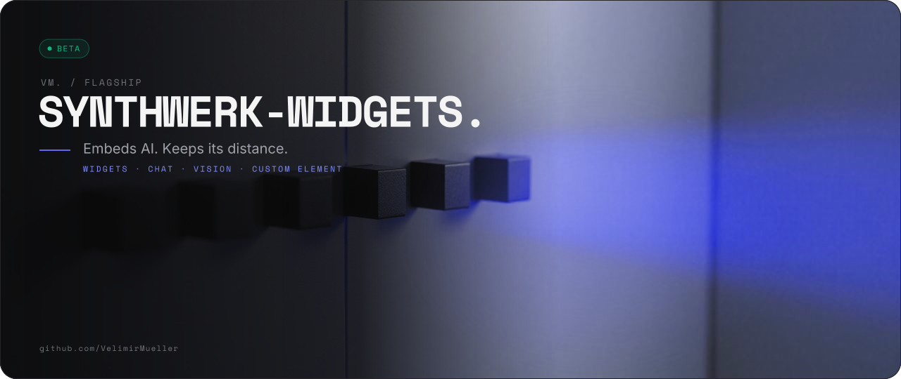
</picture>
</p>

<p>
<picture>
  <source media="(prefers-color-scheme: light)" srcset="assets/readme/lead-v2-light.svg">
  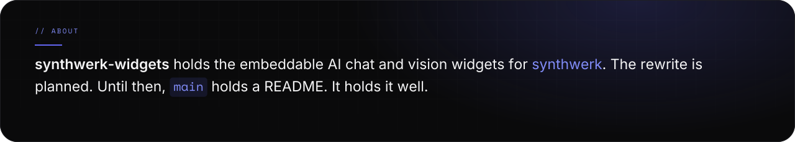
</picture>
</p>

<p>
<picture>
  <source media="(prefers-color-scheme: light)" srcset="assets/readme/stats-v2-light.svg">
  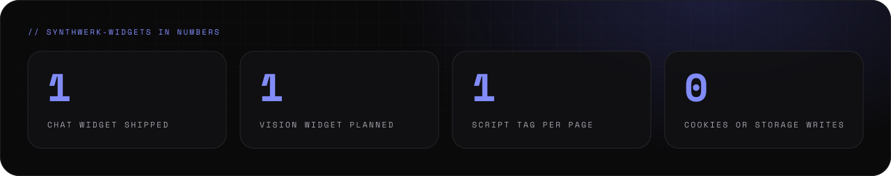
</picture>
</p>

<br>

<p>

</p>

<p>
<picture>
  <source media="(prefers-color-scheme: light)" srcset="assets/readme/features-v2-light.svg">
  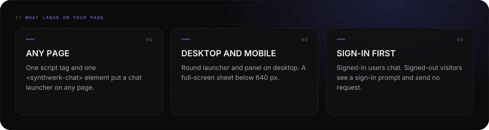
</picture>
</p>

<p>
<picture>
  <source media="(prefers-color-scheme: light)" srcset="assets/readme/what-v2-light.svg">
  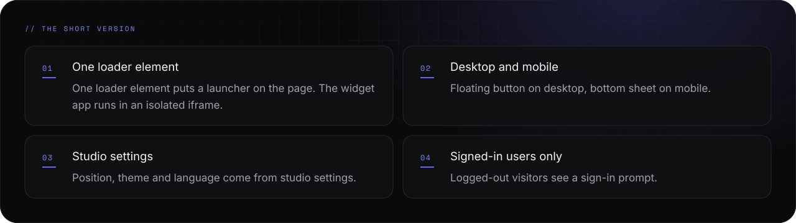
</picture>
</p>

<br>

<p>
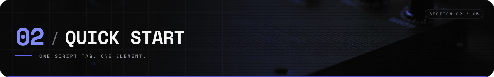
</p>

<p>
<picture>
  <source media="(prefers-color-scheme: light)" srcset="assets/readme/start-v2-light.svg">
  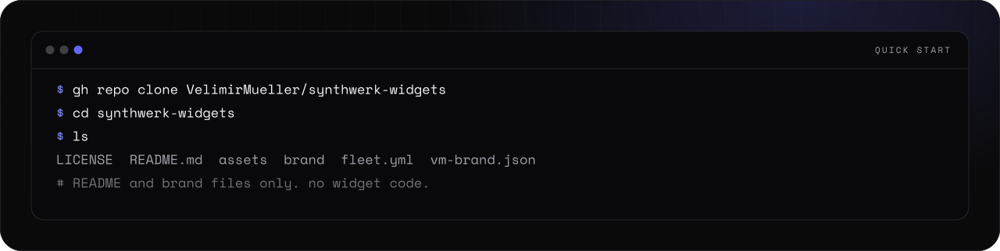
</picture>
</p>

<details>
<summary><picture><source media="(prefers-color-scheme: light)" srcset="assets/readme/links-6-v2-light.svg"></picture></summary>

```bash
gh repo clone VelimirMueller/synthwerk-widgets
cd synthwerk-widgets
ls   # LICENSE and README.md, that is all of it today
```

</details>

<p>
<picture>
  <source media="(prefers-color-scheme: light)" srcset="assets/readme/startnotes-v2-light.svg">
  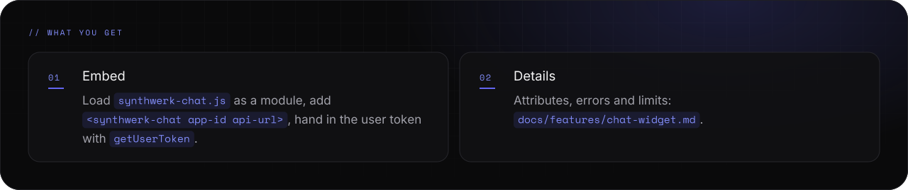
</picture>
</p>

<p align="center">
<a href="https://github.com/VelimirMueller/synthwerk"><picture><source media="(prefers-color-scheme: light)" srcset="assets/readme/links-1-v2-light.svg">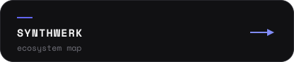</picture></a>
<a href="https://github.com/VelimirMueller/synthwerk-blueprint"><picture><source media="(prefers-color-scheme: light)" srcset="assets/readme/links-2-v2-light.svg">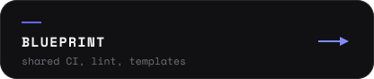</picture></a>
<a href="https://github.com/VelimirMueller/synthwerk-widgets/tree/legacy-final"><picture><source media="(prefers-color-scheme: light)" srcset="assets/readme/links-3-v2-light.svg">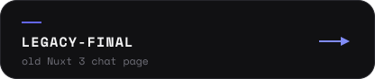</picture></a>
</p>

<br>

<p>
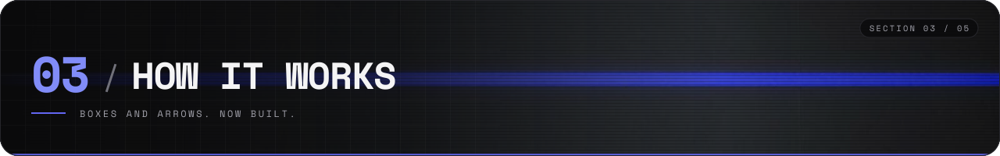
</p>

<p>
<picture>
  <source media="(prefers-color-scheme: light)" srcset="assets/readme/flow-v2-light.svg">
  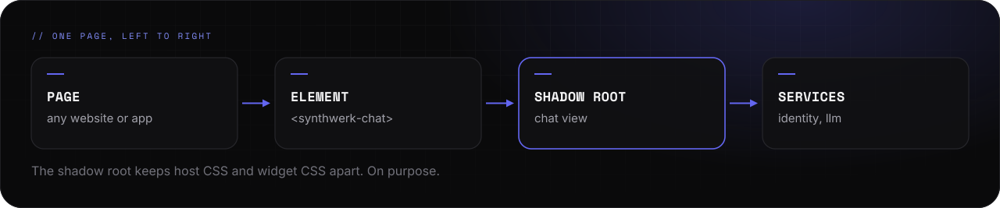
</picture>
</p>

<p>
<picture>
  <source media="(prefers-color-scheme: light)" srcset="assets/readme/hownotes-v2-light.svg">
  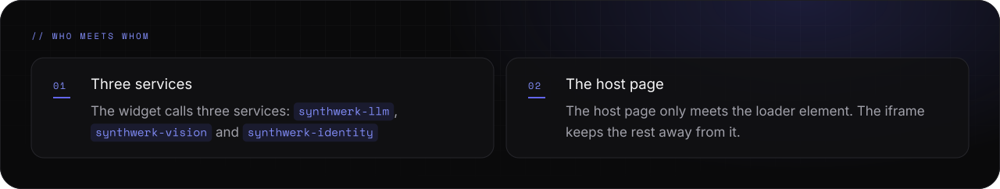
</picture>
</p>

<br>

<p>
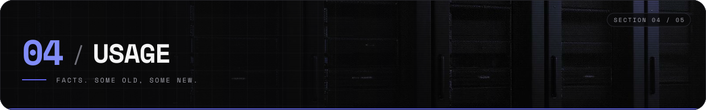
</p>

<p>
<picture>
  <source media="(prefers-color-scheme: light)" srcset="assets/readme/usage-v2-light.svg">
  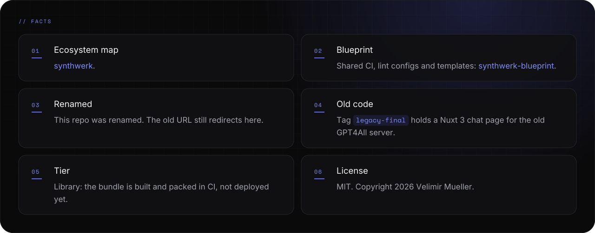
</picture>
</p>

<br>

<p>

</p>

<p>
<picture>
  <source media="(prefers-color-scheme: light)" srcset="assets/readme/status-v2-light.svg">
  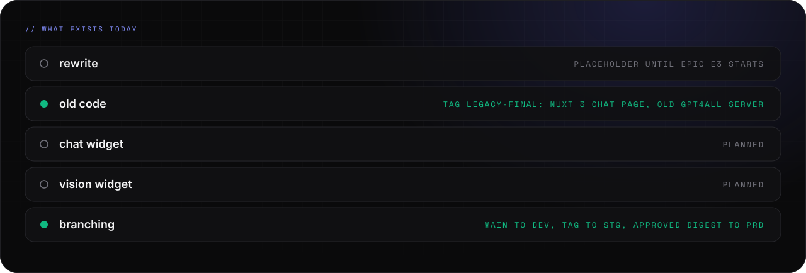
</picture>
</p>

<p>
<picture>
  <source media="(prefers-color-scheme: light)" srcset="assets/readme/statuslog-v2-light.svg">
  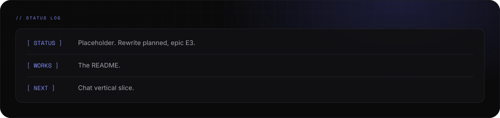
</picture>
</p>

<p>
<picture>
  <source media="(prefers-color-scheme: light)" srcset="assets/readme/honest-v2-light.svg">
  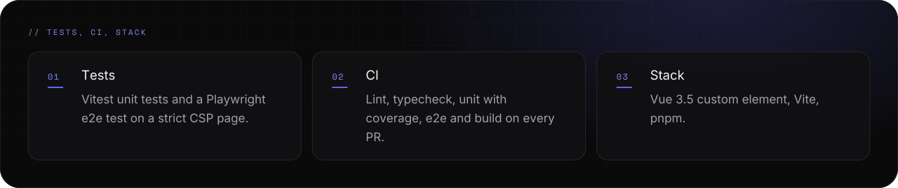
</picture>
</p>

<p align="center">
<a href="LICENSE"><picture><source media="(prefers-color-scheme: light)" srcset="assets/readme/links-4-v2-light.svg"></picture></a>
<a href="https://github.com/VelimirMueller"><picture><source media="(prefers-color-scheme: light)" srcset="assets/readme/links-5-v2-light.svg"></picture></a>
</p>

<p>
<picture>
  <source media="(prefers-color-scheme: light)" srcset="assets/readme/footer-v2-light.svg">
  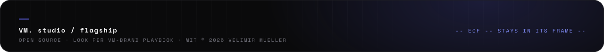
</picture>
</p>
